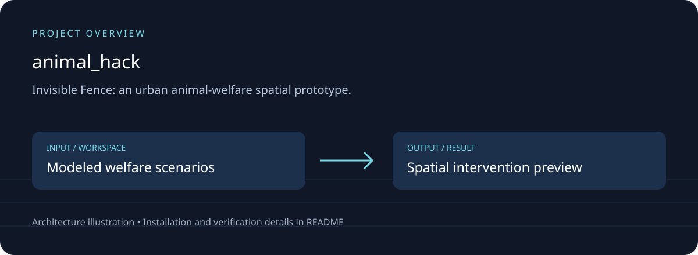
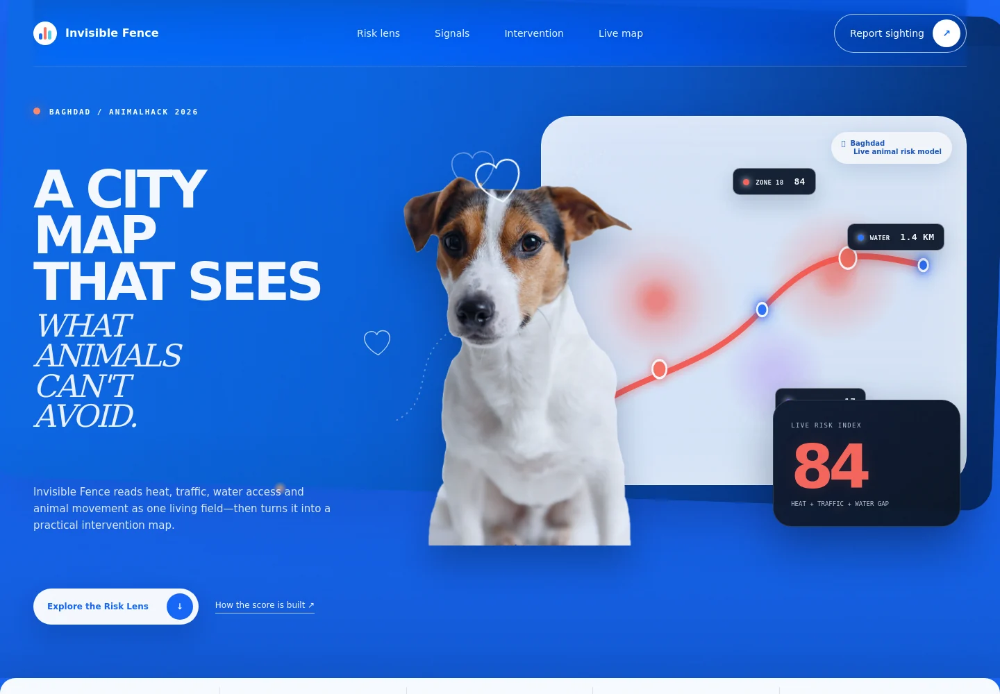

# Invisible Fence — AnimalHack 2026

## Download, setup and project overview

Invisible Fence: an urban animal-welfare spatial prototype.

Risk lens; causal story; intervention scenarios; Baghdad map; session field reports.



### Running application



Actual local browser capture from this maintenance pass; a screenshot alone does not verify every feature.

[Download source ZIP](https://github.com/ahpa5246-lgtm/animal_hack/archive/refs/heads/main.zip) · [Changes and branches](https://github.com/ahpa5246-lgtm/animal_hack/branches) · [Verification notes](docs/QUALITY_REVIEW.md)

The ZIP contains source code. Installation steps and external runtime requirements are listed below.

```bash
git clone https://github.com/ahpa5246-lgtm/animal_hack.git
cd animal_hack
```

From the repository directory:

```text
python -m http.server 8080 --bind 127.0.0.1
# Open http://127.0.0.1:8080
```

The diagram is a project illustration. Test results and runtime limitations are recorded in [the review](docs/QUALITY_REVIEW.md); it is not a production-readiness certification.


Invisible Fence is an interaction-first spatial intelligence prototype for urban animal welfare in Baghdad.

## Current experience
- **Risk Lens** — move through a stylized urban field to reveal the hidden hazard layer and local causal score.
- **Causal Story** — scroll through heat, traffic, water access, and intervention as one connected risk narrative.
- **Intervention Lab** — vary water stations, shade, and crossing warnings to preview modeled risk reduction before dispatch.
- **Live Baghdad Map** — MapLibre + OpenStreetMap with selectable risk zones, animal clusters, water points, and a time-of-day model.
- **Field Report Drawer** — add a sighting to the current demo session.

## Visual direction
Editorial spatial-intelligence interface combining restrained dark surfaces with an ivory intervention section, serif/sans typography, high-contrast data labels, and purpose-built interaction instead of generic SaaS cards or glassmorphism.

## Run in GitHub Codespaces
```bash
python3 -m http.server 8000
```
Open port **8000** and hard-refresh after pulling the latest `main` branch.

No npm install is required.
